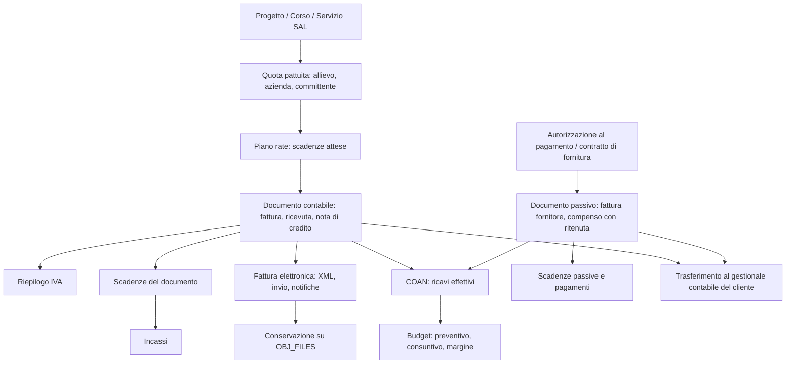

# Contabilità in Gesty — Analisi di dettaglio

## 1. Sintesi

⚠️ **Review.** Il cliente chiede "la contabilità" su Gesty, per il ramo formazione (CFP) e per il ramo Servizi al Lavoro. Il termine copre tre cose molto diverse, e solo una delle tre è oggi assente da Gesty:

| Livello | Che cos'è | Stato in Gesty |
|---|---|---|
| Contabilità **analitica** (controllo di gestione) | Quanto costa e quanto rende ogni progetto, preventivo contro consuntivo | ✅ Presente e maturo (motore COAN) |
| Contabilità **documentale** (ciclo attivo e passivo) | Fatture, ricevute, note di credito, scadenze, incassi, IVA, fattura elettronica | 🔴 Del tutto assente |
| Contabilità **generale** (partita doppia, bilancio) | Piano dei conti, prima nota, registri IVA, saldi — poi liquidazioni, cespiti, bilancio | 🔴 Assente. Il **nucleo di base è in perimetro**, gli adempimenti no |

La proposta è colmare il livello intermedio e il nucleo del terzo riusando quanto già in produzione in WT, e collegare il tutto al gestionale amministrativo del cliente con uno strato di interscambio multi-fornitore. JForma — il termine di paragone indicato dal cliente — si ferma prima: ha il ciclo documentale, non ha né prima nota né interscambio strutturato.

🔄 **Aggiornamento del 2026-07-31, seconda sessione.** Il perimetro è stato allargato su indicazione del cliente: Gesty ha un proprio nucleo contabile e scambia dati con gestionali diversi da cliente a cliente. Le sezioni 6.3, 8, 10 e 11 sono aggiornate; l'architettura dell'interscambio è nel documento `Analisi - 20260731 - Contabilità Gesty - Interscambio Con I Gestionali.md`.

---

## 2. Perimetro e metodo

Tutto quanto segue è verificato sulle fonti, non dedotto:

| Fonte | Verifica eseguita |
|---|---|
| Database `GESTY` | Elenco tabelle, colonne e procedure per parola chiave; conteggio righe per misurare l'adozione reale. Ultimo pagamento registrato: 2026-07-27, quindi la copia è recente |
| Database `CODEBRI` | Confronto di adozione su una seconda installazione |
| `D:\AI\SRC\Gesty` | Unit del `.dpr`, form e moduli dati coinvolti |
| `D:\AI\SRC\WT` | Tabelle, procedure e unit del ciclo documentale, della fattura elettronica e della contabilità generale |
| Sito e documentazione JForma | Moduli, funzioni e listino |

---

## 3. Che cosa ha già Gesty

### 3.1 🗄️ Contabilità analitica di progetto (motore COAN)

Il cuore economico di Gesty. È un motore di elaborazione che ricostruisce costi e ricavi di ogni progetto a partire dai dati operativi già presenti (ore rilevate, presenze, inquadramenti, doti).

| Tabella | Contenuto |
|---|---|
| `COAN_COSTI_RICAVI_PER_PROGETTO` | Riga unica per progetto: ore attribuite e rilevate (interni/esterni), costi personale interno/esterno e costi vari in preventivo e consuntivo, sei famiglie di ricavo, `MARGINE_PREVENTIVO` e `MARGINE_CONSUNTIVO` |
| `COAN_COSTI_RICAVI_PER_ESERCIZIO` | Le stesse grandezze spezzate per anno di esercizio, con il segnalatore `ULTIMO_ANNO` |
| `COAN_COSTI_PERSONALE_MENSILI` | Costo del personale mese per mese |
| `COAN_PRESENZE_STUDENTI` | Base di calcolo dei ricavi legati alla frequenza |
| `COAN_RICAVI_EFFETTIVI` | Ricavo effettivo per progetto e anno, inserito a mano |

Le sei famiglie di ricavo gestite: parametro specifico, corsi a pagamento, piani individuali (PIP), progetti a dote, ricavo pari ai costi, ricavi vari.

Procedure di elaborazione (24, tutte con prefisso `COAN_`): `COAN_ELABORA` guida l'intero ricalcolo e richiama le procedure di dettaglio per famiglia di costo e di ricavo, sia per progetto sia per esercizio.

Anagrafiche di supporto già presenti su `PROGETTI`:

| Campo | Significato |
|---|---|
| `CENTRO_DI_COSTO` | Centro di costo del progetto |
| `METODO_DETERMINAZIONE_RICAVI` | Regola con cui il progetto matura ricavo |
| `COSTO_CORSO_A_PAGAMENTO`, `RICAVO_ATTESO_CORSO_A_PAGAMENTO`, `RICAVO_EFFETTIVO_CORSO_A_PAGAMENTO` | Prezzo e ricavo dei corsi a pagamento |
| `DOTI_IMPORTO_DOTE_MASSIMA`, `DOTI_IMPORTO_RICONOSCIUTO_ORA_FREQUENTATA`, `DOTI_PERCENTUALE_FREQUENZA_RICONOSCIMENTO_DOTE_MAX` | Regole di maturazione della dote |
| `QUOTA_COPERTURA_COSTI_GENERALI` | Ribaltamento dei costi generali |
| `IMPORTO_COSTI_PERSONALE_NON_RICONOSCIUTI` | Quota di costo non rendicontabile |

Dettaglio di preventivo e consuntivo: `PROGETTI_COSTI_VARI` e `PROGETTI_RICAVI_VARI`, per anno di esercizio, con tipo, descrizione, importo preventivo, importo consuntivo e il segnalatore di voce non riconosciuta dal finanziatore.

Finanziamenti: `PROGETTI_FINANZIAMENTI` con `ZZ_FONTI_FINANZIAMENTO` e `ZZ_TIPO_FINANZIAMENTI`.

🖥️ Interfaccia: `frmBudget` (voce "Budget") con tavole a doppia entrata su costi e ricavi per progetto, per esercizio e sui costi mensili del personale, più il comando di rielaborazione.

### 3.2 🗄️ Costo del lavoro e autorizzazioni al pagamento

| Tabella | Contenuto |
|---|---|
| `AUTORIZZAZIONI_PAGAMENTO` | Testata per risorsa ed ente: periodo di competenza (anno/mese di inizio e fine), stato, numero, data, versione, CUP |
| `AUTORIZZAZIONI_PAGAMENTO_RIGHE` | Riga per progetto: tipo incarico, inquadramento, `COMPENSO_ORARIO_LORDO`, supplenza |
| `AUTORIZZAZIONI_PAGAMENTO_INCARICHI`, `AUTORIZZAZIONI_PAGAMENTO_ORE_RILEVATE` | Aggancio a incarichi e ore effettive |
| `PERSONALE_COSTI_ORARI`, `RISORSE_INQUADRAMENTI` | Costo orario per inquadramento |

Procedure: `AUTORIZZAZIONI_PAGAMENTO_GENERA`, `AUTORIZZAZIONI_PAGAMENTO_DETAILS`, `RISORSA_AUTORIZZAZIONI_PAGAMENTO`, `RISORSE_CALCOLA_COSTO_ENTE`.

Questo è il documento che in JForma si chiama *conferimento di incarico*. Gesty lo gestisce con più rigore (stato, numerazione, versione, competenza mensile), ma **si ferma prima del pagamento**: non c'è la fattura o la ricevuta del collaboratore, non c'è la ritenuta d'acconto, non c'è la scadenza di pagamento.

### 3.3 🗄️ Quote degli allievi

`STUDENTI_PAGAMENTI` è l'unica gestione di incasso presente, ed è minima:

```
ID_PAGAMENTO, ID_PROGETTO, ID_STUDENTE, TIPO_PAGAMENTO, DATA_PAGAMENTO, IMPORTO_PAGAMENTO, NOTE
```

Registra **solo il fatto avvenuto**. Non esiste l'importo atteso, non esistono le rate, non esiste la scadenza, non esiste il documento emesso, non esiste lo stato dell'incasso. Il collegamento con il COAN passa da `PROGETTI.RICAVO_EFFETTIVO_CORSO_A_PAGAMENTO`.

🖥️ Interfaccia: `frmPagamenti`, form generata dai metadati LZ.

### 3.4 🗄️ Altri frammenti economici

| Tabella | Contenuto | Nota |
|---|---|---|
| `STUDENTI_TIROCINI_INDENNITA` | Indennità mensile al tirocinante: fonte di finanziamento, presenze, importo, data pagamento, conto corrente | Uscita monetaria già tracciata, fuori da qualunque registro |
| `SIA_FATTURE`, `SIA_FATTURE_DESTINATARI` | Estremi e importo di fatture ricevute dalle cooperative, con periodo rendicontato | Registrazione descrittiva, non un ciclo passivo |
| `ABITARE_EMERGENZA_FATTURE`, `ABITARE_EMERGENZA_COSTI` | Stessa impostazione in ambito abitare | Idem |
| `CONTRATTI`, `CONTRATTI_FORNITURA`, `CONTRATTI_FORNITURA_PROGETTI` | Contratti di fornitura collegati ai progetti | Nessun importo maturato né fattura collegata |
| `PERSONALE_COORDINATE_BANCARIE`, `STUDENTI_CONTI_CORRENTI`, `CANDIDATURE_COORDINATE_BANCARIE`, `ZZ_BANCHE` | Coordinate bancarie | Manca l'equivalente per aziende ed enti |
| `ENTI_ANNI_ESERCIZIO` | Anni di esercizio per ente | Base già pronta per i sezionali di numerazione |

### 3.5 🔴 Che cosa manca nel modello dati

Verificato sull'elenco dei domini del database:

- **Nessun dominio IVA**: non esistono aliquota, natura dell'operazione, esigibilità, split payment.
- **Nessun dominio ritenuta**.
- **Nessun centro di ricavo** (esiste solo `CENTRO_DI_COSTO`).
- Sulle anagrafiche: `AZIENDE`, `ANAGRAFE` ed `ENTI` hanno codice fiscale, partita IVA e PEC, ma **non** il codice destinatario SDI, il regime fiscale, l'IBAN.
- Nessuna tabella di documenti fiscali di alcun tipo.

### 3.6 🔴 Servizi al Lavoro: nessuna dimensione economica

| Tabella | Contenuto |
|---|---|
| `SAL_SERVIZI` | Solo il nome del servizio, nient'altro |
| `SAL_UTENTI_SERVIZI` | Servizio erogato all'utente: sportello, operatore, data, descrizione, note |

Non c'è tariffa, non c'è durata valorizzata, non c'è collegamento al progetto o al finanziamento, non c'è committente da fatturare. Il ramo Servizi al Lavoro è, dal punto di vista economico, un foglio bianco: qualunque contabilità va progettata da zero, a partire da come il cliente viene pagato (a ore rendicontate, a servizio erogato, a esito occupazionale).

### 3.7 Adozione reale

| Grandezza | `GESTY` | `CODEBRI` |
|---|---|---|
| Progetti | 1.475 | 480 |
| Progetti con COAN elaborato | 1.459 | 0 |
| Pagamenti allievi registrati | 5.522 | 0 |
| Righe di costo vario a preventivo | 1 | 0 |
| Righe di ricavo vario | 0 | 0 |

⚠️ **Come vanno letti questi numeri.** Il COAN è **stato introdotto da poco ed è in fase di avviamento**: non tutte le modalità di determinazione dei ricavi sono state realizzate e le voci di dettaglio non sono ancora popolate. I conteggi qui sopra fotografano un modulo giovane, non un modulo abbandonato. La conseguenza per questo progetto resta però la stessa: la parte automatica funziona (costo del personale dalle ore), la parte che dipende da un inserimento manuale è quella che rallenta l'avviamento, e alimentarla dai documenti amministrativi è il modo più rapido per completarla.

---

## 4. Che cosa offre JForma

JForma è un gestionale in rete per enti di formazione, con moduli a canone. Le funzioni contabili si distribuiscono così.

### 4.1 Rendiconto di corso (compreso nel piano base)

- Due tabelle per corso: ricavi e costi, con filtri e barra comandi.
- Importazione automatica degli operatori assegnati al corso, con le ore prese dal calendario e l'importo orario dall'anagrafica; ruoli gestiti: coordinatore, tutor, docente, direttore, progettista, selezionatore, tutor a distanza, assistente pratico, mentore.
- Voci di spesa manuali per quanto non dipende da persone (affitti, materiali, utenze).
- Calcolo automatico di **totale lordo** (importo orario × ore + rimborsi), **ritenuta** (solo sul compenso, non sui rimborsi) e **netto**.
- Ricavi importati dai pagamenti registrati su corsisti e aziende, confrontati con il **prezzo pattuito**; semaforo verde/rosso/blu su incasso pari, inferiore o superiore all'atteso.
- Pagamenti frazionati agli operatori (acconto e saldo) e stati particolari: caparra, rimborsato, non fatturare, escluso dal rendiconto.
- **Utile/MOL** calcolato in euro e in percentuale sui ricavi.
- **Centri di spesa**: ogni voce di costo si collega alla voce del piano dei conti richiesta dal finanziatore, con preventivo per voce e inserimento automatico nel rendiconto.
- **Conferimenti di incarico**: modelli con segnaposti, stampa e invio via email con tracciamento.

### 4.2 Contabilità del corsista, rate e pagamenti (compresa)

- Da 1 a 12 rate, importo diviso in parti uguali con il resto sull'ultima, modificabile voce per voce.
- Scadenze a partire dalla data di iscrizione, con cadenza configurabile.
- Più listini di prezzo selezionabili dal corsista, sconti in percentuale o in euro con codici sconto.
- Promemoria ed **eventuali solleciti automatici via email**, con collegamento diretto al pagamento e riepilogo della situazione rate.
- Stati tracciati: attesa pagamento, scaduta non pagata, pagata, rimborso parziale o totale, revocata.

### 4.3 Moduli a pagamento

| Modulo | Prezzo | Contenuto |
|---|---|---|
| Fatturazione | 190 €/anno | Fatture elettroniche B2B, B2C e PA; proforma, note di credito, preventivi; aliquote IVA e termini di pagamento; split payment e bollo virtuale; catalogo prodotti e sconti; invio via email; recapito del ciclo passivo; conservazione a norma per 10 anni acquistata a consumo |
| Ricevute web | 80 €/anno | Ricevute numerate progressivamente, giorni di modificabilità, emissione rapida degli acconti |
| Gateway PayPal | 80 €/anno | Incasso con carta o PayPal, anche in tre rate; aggiorna la contabilità e può creare la fattura |
| Coupon | — | Codici sconto con misurazione dell'efficacia |
| Importazioni anagrafiche | — | Caricamento massivo di aziende, corsisti e dati di pagamento da foglio elettronico |
| Servizi web e viste logiche, API | — | Lettura dei dati dall'esterno, iscrizioni e pagamenti da siti di commercio elettronico |

Piani: Lite gratuito (4 corsi, 300 corsisti), Professional da 779 €/anno più 320 € di attivazione, Premium 2.266 €/anno, Enterprise 3.630 €/anno con tutti i moduli compresi.

### 4.4 Fatturazione automatica

La fattura nasce da sola quando il corsista completa il pagamento in autoiscrizione o quando si carica il bonifico: usa i dati di fatturazione del corsista se presenti, altrimenti l'anagrafica; numera secondo il centro di ricavo scelto; emette sempre tipo documento TD01; con l'opzione dedicata produce il file XML nel formato FatturaPA 1.2 e lo mette in coda verso lo SDI, allegando il PDF alla email per il corsista.

### 4.5 Che cosa JForma **non** fa

- Nessuna contabilità generale, nessuna prima nota, nessun bilancio, nessun registro IVA: l'uscita verso la contabilità è un foglio elettronico.
- Nessuna gestione dei Servizi al Lavoro.
- Il rendiconto di corso è per corso: non esiste il consolidamento per esercizio né il confronto preventivo-consuntivo pluriennale che Gesty fa con il COAN.

---

## 5. Matrice funzionale

Legenda: ✅ presente e maturo · 🟡 presente ma parziale · 🔴 assente.

| # | Funzione | Gesty | JForma | In WT | Divario da colmare |
|---|---|:--:|:--:|:--:|---|
| 1 | Preventivo di progetto per voce di spesa | 🟡 | ✅ | 🔴 | Struttura c'è (`PROGETTI_COSTI_VARI`), non è usata: serve interfaccia usabile e voci predefinite |
| 2 | Consuntivo costi personale da ore effettive | ✅ | 🟡 | 🔴 | — |
| 3 | Consuntivo per esercizio e pluriennale | ✅ | 🔴 | 🔴 | — |
| 4 | Margine / MOL | ✅ | ✅ | 🔴 | — |
| 5 | Centri di costo | ✅ | ✅ | ✅ | — |
| 6 | Centri di ricavo e sezionali | 🔴 | ✅ | ✅ | Da introdurre |
| 7 | Prezzo pattuito per allievo o azienda | 🔴 | ✅ | ✅ | Da introdurre |
| 8 | Piano rate con scadenze | 🔴 | ✅ | ✅ (`DOC_SCADENZE`, `DOC_RATEIZZA_FATTURE`) | Da introdurre |
| 9 | Incassi collegati alla scadenza | 🟡 | ✅ | ✅ (`CG_INCASSI*`) | `STUDENTI_PAGAMENTI` da agganciare |
| 10 | Solleciti automatici | 🔴 | ✅ | 🟡 | Motore messaggi già presente in Gesty, manca l'innesco |
| 11 | Fattura, nota di credito, proforma, preventivo | 🔴 | ✅ | ✅ | Da costruire |
| 12 | Ricevuta numerata | 🔴 | ✅ | ✅ (`DOC_RICEVUTE`) | Da costruire |
| 13 | Riepilogo IVA, esigibilità, natura | 🔴 | ✅ | ✅ (`DOC_IVA`) | Da costruire |
| 14 | Split payment, bollo virtuale | 🔴 | ✅ | ✅ | Da costruire |
| 15 | Fattura elettronica e notifiche SDI | 🔴 | ✅ | ✅ (`FE_FATTURE_*`, `DOCUMENTI_FE_INVII_SDI`) | Riuso |
| 16 | Conservazione a norma | 🟡 | ✅ | 🟡 | Motore conservazione già progettato nel sistema documentale |
| 17 | Incasso online | 🔴 | ✅ | ✅ (PagoPA) | Opzionale |
| 18 | Ciclo passivo: fatture fornitori | 🟡 | 🟡 | ✅ | Da costruire |
| 19 | Compensi collaboratori con ritenuta | 🟡 | ✅ | 🔴 | Estensione di `AUTORIZZAZIONI_PAGAMENTO` |
| 20 | Piano dei conti, prima nota, registri IVA, saldi | 🔴 | 🔴 | ✅ (`COGE_*`) | **In perimetro**, per riuso |
| 21 | Liquidazioni, dichiarativi, cespiti, bilancio | 🔴 | 🔴 | 🟡 | **Fuori perimetro** |
| 22 | Interscambio con il gestionale del cliente | 🔴 | 🟡 (foglio elettronico) | ✅ (`CG_EP_FATTURATO_PER_CONTAB_*`, `AZ_SOTTOCONTI_*`) | Da costruire, multi-fornitore |
| 22 | Economia dei Servizi al Lavoro | 🔴 | — | 🔴 | Da progettare da zero |

---

## 6. Che cosa si riusa da WT

### 6.1 🗄️ Fattura elettronica — riuso alto

| Oggetto | Contenuto |
|---|---|
| `FE_FATTURE_1_1_DATI_TRASMISS` … `FE_FATTURE_2_1_X_1_DATI_DETT` (circa 20 tabelle) | Il tracciato FatturaPA mappato uno a uno sulle sezioni dello schema ministeriale |
| `DOCUMENTI_FE_INVII_SDI` | Un invio per documento: nome del file XML, dimensione, orario, esito, tipo comunicazione, codice destinatario, PEC, dati del cessionario, segnalatore di scarto |
| `FPA_TRASMIETTENTI`, `FPA_TERZI_INTERMEDIARI`, `FPA_POSTEL_FLUSSI` | Soggetto trasmittente, intermediario e flussi verso il recapitatore |
| `Schema_del_file_xml_FatturaPA_versione_12.pas`, `..._121a.pas`, `DatiFatturav20.pas` | Classi generate dallo schema XML: già indipendenti dall'applicazione |
| `dmFPA_WebService` | Dialogo con il servizio dell'intermediario: accesso con token e rinnovo, `UploadFile`, `MonitorStatoFlussiInviati`, `DownloadFattura`, `DownloadNotificheSDI`, `DownloadEsibizioneANorma` |
| `dmFPA_Documenti`, `dmFattureElettroniche`, `dmFatturaElettronicaInvii`, `frmFPA_Documenti`, `frmFatturaElettronicaInvii` | Interfaccia di gestione degli invii e degli esiti |

### 6.2 🗄️ Ciclo documentale — riuso del modello, non delle tabelle

`DOCUMENTI` in WT è la testata di un documento fiscale completa di tutto quello che serve (tipo, serie, numero, data, intestatario congelato, recapito, split payment, CIG, codice pagamento, mandato di addebito, conto corrente), ma è **profondamente legata alla tassa rifiuti**: codice Belfiore del comune, contratto, categoria, emissione. Con lei viaggiano `DOC_CORPO`, `DOC_IVA`, `DOC_SCADENZE`, `DOC_RICEVUTE`, `DOC_STORNI` e le procedure `DOC_GENERA_FATTURA*`, `DOC_FATTURAZIONE_MASSIVA`, `DOC_RATEIZZA_FATTURE`, `DOC_RICALCOLA_FATTURA`.

Si riusa la **forma** (testata / righe / riepilogo IVA / scadenze / incassi / storni, più la fotografia dei dati dell'intestatario al momento dell'emissione, che è un obbligo fiscale), non le tabelle.

### 6.3 🟢 Contabilità generale — riuso alto, nella forma ridotta

WT ha una contabilità generale completa: piano dei conti a quattro livelli (`COGE_PCON_01_GRUPPI` … `COGE_PCON_04_SOTTOCONTI`), `COGE_REGISTRAZIONI`, `COGE_REG_MOVIMENTI` con dare e avere vincolati e saldo calcolato, `COGE_REG_SCADENZE`, `COGE_CAUSALI_CONTABILI`, `COGE_OBJ` per legare la scrittura all'oggetto che l'ha generata, saldi e consolidamento, con circa 29 procedure dedicate.

Con il perimetro aggiornato **è questa l'ossatura del nucleo contabile di Gesty**: il piano dei conti, le causali, le registrazioni in partita doppia, i movimenti e i saldi si portano quasi per intero. Restano fuori solo le procedure di generazione dalle entrate tributarie (`COGE_GENERA_REG_ENTRATE*`, `COGE_RIGENERA_ENTRATE_PAGOPA`), che vanno riscritte sui documenti di Gesty.

Restano fuori dal perimetro gli adempimenti che vengono dopo la scrittura — liquidazioni IVA, dichiarativi, cespiti, ratei e risconti, chiusura e bilancio: cambiano ogni anno e sono già coperti dal gestionale contabile che il cliente ha in casa.

⚠️ In Gesty il prefisso `COGE_` non si porta: è un'abbreviazione. I nomi vanno per esteso — `CONTABILITA_PIANO_DEI_CONTI_*`, `CONTABILITA_CAUSALI`, `CONTABILITA_REGISTRAZIONI`, `CONTABILITA_REGISTRAZIONI_MOVIMENTI`, `CONTABILITA_SALDI`.

Per il punto di uscita, WT offre il modello nelle procedure `CG_EP_FATTURATO_PER_CONTAB_*` e nelle tabelle `AZ_SOTTOCONTI_*`, che mappano gli oggetti applicativi sui sottoconti del sistema contabile esterno. Il dettaglio dello strato di interscambio è nel documento dedicato.

---

## 7. Architettura proposta

### 7.1 Flusso



### 7.2 🗄️ Modello dati nuovo

Entità fulcro: il documento contabile. Tutte le tabelle nuove ne portano il prefisso, secondo la convenzione già adottata per `OBJ_FILES_*`.

| Tabella | Contenuto | Note |
|---|---|---|
| `DOCUMENTI_CONTABILI` | Testata: ente, anno di esercizio, sezionale, tipo documento, numero, data, tipo registro (attivo/passivo), soggetto e suoi dati fiscali congelati, totali, stato, riferimento al documento di origine per note di credito e storni | Registro unico per tutti i tipi |
| `DOCUMENTI_CONTABILI_RIGHE` | Righe: progetto, corso, centro di costo, descrizione, quantità, prezzo unitario, sconto, aliquota, imponibile | Il collegamento al progetto è ciò che chiude il cerchio con il COAN |
| `DOCUMENTI_CONTABILI_IVA` | Riepilogo per aliquota: imponibile, imposta, natura dell'operazione, esigibilità, riferimento normativo | Necessario per la fattura elettronica |
| `DOCUMENTI_CONTABILI_SCADENZE` | Rate attese: data, importo, modalità di pagamento, stato | Vale sia per l'attivo sia per il passivo |
| `DOCUMENTI_CONTABILI_INCASSI` | Incassi e pagamenti collegati alla scadenza: data, importo, modalità, estremi | Vi confluisce `STUDENTI_PAGAMENTI` |
| `DOCUMENTI_CONTABILI_RITENUTE` | Ritenuta d'acconto e contributi previdenziali sul documento passivo | Serve per i compensi ai collaboratori |
| `DOCUMENTI_CONTABILI_INVII_SDI` | Invio allo SDI ed esiti | Copia adattata di `DOCUMENTI_FE_INVII_SDI` |
| `ENTI_SEZIONALI` | Sezionali di numerazione per ente, anno di esercizio e tipo documento | Si appoggia su `ENTI_ANNI_ESERCIZIO` già esistente |
| `ZZ_ALIQUOTE_IVA` | Aliquote con natura ed esigibilità | Tabella di appoggio |
| `ZZ_MODALITA_PAGAMENTO` | Modalità di pagamento con il codice del tracciato elettronico | Tabella di appoggio |
| `PROGETTI_QUOTE` | Listino del progetto: quota intera, quote ridotte, numero rate previste | Il "multiprezzo" di JForma |
| `STUDENTI_PROGETTI_QUOTE` | Quota pattuita sull'iscrizione e piano rate generato | È il pezzo che oggi manca del tutto |
| `AZIENDE_COORDINATE_BANCARIE` | Coordinate bancarie delle aziende | Simmetrica a `PERSONALE_COORDINATE_BANCARIE` |
| `CONTABILITA_PIANO_DEI_CONTI_*`, `CONTABILITA_CAUSALI`, `CONTABILITA_REGISTRAZIONI`, `CONTABILITA_REGISTRAZIONI_MOVIMENTI`, `CONTABILITA_SALDI` | Nucleo contabile: conti, causali, scritture in partita doppia, saldi | Per riuso da `COGE_*`, con i nomi per esteso |
| `CONTABILITA_INTERSCAMBIO_*` | Fornitori, configurazioni, tracciati, mappature, lotti ed esiti dello scambio con il gestionale del cliente | Dettaglio nel documento sull'interscambio |

Estensioni ad anagrafiche esistenti:

| Tabella | Campi da aggiungere |
|---|---|
| `AZIENDE`, `ANAGRAFE`, `ENTI` | `CODICE_DESTINATARIO_SDI`, `REGIME_FISCALE`, `SPLIT_PAYMENT`, `ESENZIONE_IVA`, `TERMINI_PAGAMENTO` |
| `RISORSE` | `REGIME_FISCALE`, `ALIQUOTA_RITENUTA`, `CASSA_PREVIDENZIALE` |
| `SAL_SERVIZI` | `TARIFFA`, `UNITA_DI_MISURA`, `TIPO_RICAVO` — è la tabella che oggi contiene solo il nome del servizio |

### 7.3 🗄️ Domini nuovi

Esempio conforme alle regole del progetto (dominio a valori chiusi con commento che genera l'elenco a discesa):

```sql
CREATE DOMAIN TIPO_DOCUMENTO_CONTABILE AS VARCHAR(3)
    CHECK (VALUE IN ('FAT', 'RIC', 'NDC', 'PRO', 'PRE', 'FPA') OR (VALUE IS NULL));

COMMENT ON DOMAIN TIPO_DOCUMENTO_CONTABILE IS 'Fattura              = FAT
Ricevuta             = RIC
Nota di credito      = NDC
Proforma             = PRO
Preventivo           = PRE
Fattura fornitore    = FPA';
```

Altri domini previsti: `TIPO_REGISTRO_CONTABILE` (attivo/passivo), `STATO_DOCUMENTO_CONTABILE`, `STATO_SCADENZA`, `NATURA_IVA`, `ESIGIBILITA_IVA`, `REGIME_FISCALE`, `MODALITA_PAGAMENTO`. Gli importi usano i domini `VALUTA_2` e `VALUTA_2_POSITIVA` già presenti.

### 7.4 Matrice degli stati del documento

| Codice | Descrizione | Innesco | Transizioni ammesse | Spiegazione logica |
|---|---|---|---|---|
| `BOZ` | Bozza | Creazione | `EMS`, eliminazione | Finché è bozza non consuma numerazione: il numero è un bene fiscale e non può avere buchi |
| `EMS` | Emesso | Emissione con assegnazione del numero | `INV`, `INC`, `STO` | Da qui il documento è immodificabile nei dati fiscali |
| `INV` | Inviato allo SDI | Trasmissione del file XML | `ACC`, `SCA` | Stato transitorio, in attesa della notifica |
| `ACC` | Accettato | Notifica di consegna o di mancata consegna | `INC`, `STO` | La mancata consegna è comunque un esito valido: la fattura esiste |
| `SCA` | Scartato | Notifica di scarto | `EMS` | Il documento torna correggibile mantenendo il numero, come previsto dalla normativa |
| `INC` | Incassato | Somma degli incassi pari al totale | `STO` | Calcolato, non impostato a mano |
| `STO` | Stornato | Nota di credito collegata | — | Stato finale: non si cancella un documento emesso, lo si storna |

### 7.5 💻 Codice e logica applicativa

Unit riusabili, senza prefisso applicativo e senza dipendenze da `Gesty.Globals` o da `dmCommon`:

| Unit | Responsabilità |
|---|---|
| `Contabilita.Types` | Tipi, stati, enumerazioni |
| `Contabilita.Numerazione` | Assegnazione del numero per sezionale, con la garanzia di continuità |
| `Contabilita.Calcoli` | Imponibili, IVA, arrotondamenti, ritenute, bollo, split payment |
| `Contabilita.PianoRate` | Generazione delle scadenze da quota e cadenza |
| `Contabilita.FatturaElettronica.Builder` | Costruzione del file XML, sopra le classi dello schema già presenti in WT |
| `Contabilita.Bridge.SDI` | Ponte verso l'intermediario, con la stessa interfaccia per più fornitori — stessa impostazione dei motori documentali `Documentazione.*` già adottata |
| `dmContabilita` | Modulo dati ponte fra il motore e l'applicazione |

Il ponte verso lo SDI va scritto con la stessa forma dei motori documentali esistenti (`Documentazione.Bridge.Firma`, `Documentazione.Bridge.Protocollo`): interfaccia unica, fornitore configurabile, prova della connessione.

### 7.6 🖥️ Interfaccia

Form nuove, generate dai metadati LZ come le altre form documentali:

| Form | Contenuto |
|---|---|
| `ContabilitaDocumenti` | Registro dei documenti con righe, IVA, scadenze, incassi e allegati |
| `ContabilitaScadenzario` | Scadenze aperte, insoluti, solleciti |
| `ContabilitaIncassi` | Registrazione degli incassi, anche massiva |
| `ContabilitaEsportazioni` | Esportazione verso la contabilità esterna |
| `ContabilitaConfigurazione` | Sezionali, aliquote, mappatura dei conti, fornitore SDI |

Form esistenti da estendere: `frmProgetti` (quote e listino), `frmStudenti` (piano rate e situazione dell'allievo), `frmAziende` (dati fiscali e documenti), `frmBudget` (i ricavi effettivi arrivano dai documenti, non più a mano), `frmPagamenti` (diventa la vista degli incassi).

⚠️ Ogni nuova form LZ richiede la creazione dei moduli dati, dei dataset e delle viste nei metadati; rinominare in seguito un modulo dati o una form lascia orfani gli oggetti LZ, che vanno rimappati.

---

## 8. Fasi di lavoro

| Fase | Contenuto | Impatto | Priorità | Stima indicativa |
|---|---|---|---|---|
| 1 | Anagrafiche fiscali, aliquote, sezionali, listini e quote | 🗄️ 💻 🖥️ | 🔴 | 10-15 gg |
| 2 | Registro documenti attivo: fattura, ricevuta, nota di credito, proforma, preventivo; righe; IVA; scadenze; incassi; travaso di `STUDENTI_PAGAMENTI` | 🗄️ 💻 🖥️ | 🔴 | 25-35 gg |
| 3 | Nucleo contabile: piano dei conti, causali, registrazioni in partita doppia dai documenti, registri IVA, saldi — per riuso da `COGE_*` | 🗄️ 💻 🖥️ | 🔴 | 20-25 gg |
| 4 | Fattura elettronica: XML, invio, notifiche, conservazione — per riuso da WT | 🗄️ 💻 🖥️ | 🔴 | 15-20 gg |
| 5 | Interscambio, gradini 1 e 2: file XML verso il gestionale, motore dei tracciati, mappature, lotti ed esiti | 🗄️ 💻 🖥️ | 🔴 | 20-28 gg |
| 6 | Ciclo passivo: fatture fornitori, compensi con ritenuta a partire dalle autorizzazioni al pagamento; aggancio al COAN | 🗄️ 💻 🖥️ | 🟡 | 15-20 gg |
| 7 | Interscambio, gradino 3: primo connettore nativo | 💻 | 🟢 | 10-15 gg per fornitore |
| 8 | Solleciti automatici e incasso online | 💻 🖥️ | 🟢 | 10-15 gg |
| 9 | Economia dei Servizi al Lavoro: tariffa, maturazione, fatturazione al committente | 🗄️ 💻 🖥️ | 🟡 | 12-18 gg |

Le stime sono indicative, riferite allo sviluppo, e non comprendono l'analisi funzionale con il cliente, il collaudo, la migrazione dei dati e la formazione.

---

## 9. Rischi

| Rischio | Gravità | Contromisura |
|---|---|---|
| Doppia verità fra Gesty e il gestionale del cliente | 🔴 | Tabella della proprietà del dato concordata prima di scrivere codice: un solo padrone per ogni entità, un solo canale per ogni flusso, nessuna riesportazione di ciò che è già stato accettato |
| Continuità della numerazione fiscale | 🔴 | Il numero si assegna solo all'emissione, in transazione, per sezionale; nessuna cancellazione di documenti emessi, solo storni |
| Adempimenti che cambiano (tracciato, esterometro, conservazione) | 🟡 | Il tracciato sta in tabelle mappate uno a uno sullo schema, come in WT: si adegua senza toccare la logica |
| Il modulo resta poco usato, come è successo alle voci manuali del COAN in avviamento | 🟡 | Legare ogni inserimento a un ritorno immediato (rate → solleciti, fattura → margine) e verificare prima di partire chi emetterà materialmente i documenti |
| Perimetro dei Servizi al Lavoro non definito | 🔴 | Non aprire la fase 7 finché non è chiaro come il cliente viene pagato |
| Multi-ente e multi-sede | 🟡 | Sezionale per ente fin dal modello dati, non aggiunto dopo |

---

## 10. Quadro decisionale

| Punto | Scelta proposta | Motivo |
|---|---|---|
| Nucleo contabile in Gesty | Sì, ridotto: conti, causali, prima nota, registri IVA, saldi | Senza scritture non c'è prima nota da passare al gestionale; gli adempimenti restano fuori perché cambiano ogni anno |
| Collegamento con il gestionale del cliente | Strato multi-fornitore a tre gradini, con i tracciati definiti come dato | Il gestionale cambia da cliente a cliente: un connettore per cliente sarebbe ingestibile |
| Registro unico o tabelle per tipo documento | Registro unico con tipo e tipo registro | Fattura, ricevuta e nota di credito condividono struttura, numerazione e scadenze |
| Fattura elettronica | Riuso del percorso WT con ponte multi-fornitore | Il tracciato e le classi XML esistono già e sono in produzione |
| Conservazione a norma | Sul sistema documentale `OBJ_FILES` | Il motore di conservazione è già progettato; evita un secondo archivio |
| Quote allievi | Piano rate sull'iscrizione, incasso agganciato alla scadenza | È l'unico modo per avere l'atteso e quindi gli insoluti |
| `STUDENTI_PAGAMENTI` | Migrato in `DOCUMENTI_CONTABILI_INCASSI` senza documento collegato | 5.522 righe da non perdere |
| Ricavi effettivi del COAN | Alimentati dai documenti emessi | Oggi si inseriscono a mano ed è la principale fonte di errore |

---

## 11. Punti aperti per il cliente

| # | Domanda | Perché è bloccante |
|---|---|---|
| 1 | Quali gestionali usano i clienti, chi possiede l'anagrafica clienti, chi numera le fatture, chi riconcilia la banca? | Sono le quattro domande che reggono l'intero interscambio: dettaglio nel documento dedicato |
| 2 | Con quale intermediario si trasmette allo SDI? | Determina il ponte da scrivere per primo |
| 3 | Quanti enti emettono documenti e con quali sezionali? | Il modello di numerazione non si cambia dopo |
| 4 | Nei Servizi al Lavoro si viene pagati a ore rendicontate, a servizio erogato o a esito? | Il modello dati della fase 7 dipende interamente da questo |
| 5 | Serve l'incasso online delle quote? | Rimandabile, ma condiziona il piano rate |
| 6 | Chi emetterà materialmente i documenti, e oggi come li reimputa nel gestionale contabile? | Misura il tempo che il progetto restituisce, ed è la verifica che il modulo verrà usato |

---

## Fonti

- Documento collegato: `Analisi - 20260731 - Contabilità Gesty - Interscambio Con I Gestionali.md`, nella stessa cartella.
- Database `GESTY` e `CODEBRI`, letti il 2026-07-31; ultimo pagamento registrato in `GESTY`: 2026-07-27.
- Sorgenti in `D:\AI\SRC\Gesty` e `D:\AI\SRC\WT` (unit del `.dpr`, tabelle e procedure in `WT\DB`).
- [Caratteristiche Jforma](https://www.jforma.it/caratteristiche/) · [Moduli aggiuntivi](https://www.jforma.it/moduli-aggiuntivi/) · [Fatturazione](https://www.jforma.it/fatturazione/) · [Prezzi](https://www.jforma.it/prezzi/) · [Rendiconto di corso](https://documentazione.jforma.it/docs/rendiconto-di-corso/) · [Gestione rate e pagamenti](https://documentazione.jforma.it/docs/gestione-rate-e-pagamenti/) · [Fatturazione automatica](https://documentazione.jforma.it/docs/fatturazione-automatica/) · [Fatturazione elettronica](https://www.jforma.it/fatturazione-elettronica/)
