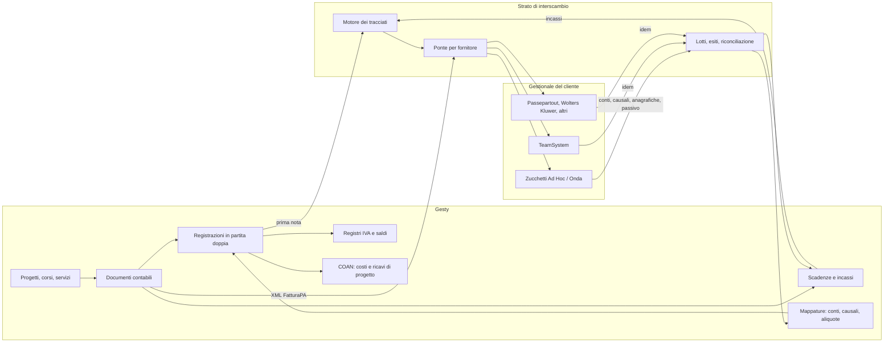

# Contabilità in Gesty — Core contabile e interscambio con i gestionali del cliente

## 1. Sintesi

⚠️ **Review.** Questo documento aggiorna il perimetro deciso nei due precedenti: Gesty **ha un proprio nucleo di contabilità di base** e dialoga in entrata e in uscita con il gestionale amministrativo del cliente, che cambia da cliente a cliente (Zucchetti Ad Hoc, Zucchetti Onda, TeamSystem, Passepartout Mexal, Wolters Kluwer B.Point e altri).

Tre conseguenze immediate rispetto all'analisi precedente:

| Punto | Prima | Adesso |
|---|---|---|
| Contabilità generale in Gesty | Esclusa | **Inclusa nella forma ridotta**: piano dei conti, causali, registrazioni in partita doppia, registri IVA, saldi. Restano fuori liquidazioni, dichiarativi, cespiti e bilancio |
| Riuso di `COGE_*` da WT | Da non portare | **Diventa l'ossatura**: in WT esiste già ed è in produzione |
| Uscita verso la contabilità | Una esportazione | **Uno strato di interscambio multi-fornitore**, con la stessa impostazione dei motori documentali già adottati in Gesty |

Il principio che regge tutto: **un solo padrone per ogni dato**. Gesty è padrone di ciò che nasce dall'attività formativa (documenti emessi, quote, incassi, compensi, imputazione ai progetti); il gestionale del cliente è padrone di ciò che riguarda l'azienda nel suo insieme (piano dei conti, liquidazioni, bilancio). Dove i due si toccano si passa un dato, non si duplica una gestione.

---

## 2. Che cosa entra nel nucleo contabile di Gesty

| Dentro | Perché |
|---|---|
| Piano dei conti (gruppi, mastri, conti, sottoconti) | Senza conti non esiste registrazione né mappatura verso l'esterno |
| Causali contabili | Definiscono lo schema della scrittura per ogni tipo di documento |
| Registrazioni in partita doppia con dare e avere | È la forma in cui ogni gestionale si aspetta di ricevere la prima nota |
| Registri IVA (vendite, acquisti, corrispettivi) | Sono la conseguenza automatica dei documenti, non un adempimento |
| Scadenzario e partite aperte | È l'informazione che il cliente vuole vedere dentro Gesty, non nel gestionale |
| Saldi progressivi dei conti | Servono per il controllo, non per il bilancio |
| Imputazione ai progetti e ai centri di costo | È il ponte con il COAN: nessun gestionale commerciale sa farlo sui progetti formativi |

| Fuori | Perché |
|---|---|
| Liquidazione IVA e versamenti | Adempimento periodico che cambia ogni anno, già coperto dal gestionale contabile del cliente |
| Dichiarativi, certificazione unica, modelli | Stesso motivo, con in più la responsabilità professionale |
| Cespiti e ammortamenti | Non nascono dall'attività formativa |
| Ratei, risconti, scritture di assestamento | Si fanno in contabilità generale, dove l'ente la tiene oggi |
| Chiusura d'esercizio e bilancio | Punto di arrivo del gestionale, non di Gesty |

La linea di taglio è netta: **Gesty registra ciò che genera, il gestionale chiude l'esercizio.**

---

## 3. Riuso da WT: `COGE_*` diventa l'ossatura

Con il nuovo perimetro, la contabilità generale già presente in WT torna in gioco. È in produzione, è generica e copre esattamente il nucleo ridotto descritto sopra.

| Oggetto WT | Contenuto | Riuso |
|---|---|---|
| `COGE_PCON_01_GRUPPI` … `COGE_PCON_04_SOTTOCONTI` | Piano dei conti a quattro livelli, per azienda, con sottoconto completo calcolato | 🟢 Alto |
| `COGE_CAUSALI_CONTABILI` | Causali contabili | 🟢 Alto |
| `COGE_REGISTRAZIONI` | Testata: azienda, anno e mese di esercizio, data contabile, causale, descrizione, consolidamento | 🟢 Alto |
| `COGE_REG_MOVIMENTI` | Riga: sottoconto, contropartita, dare, avere con vincolo che impedisce di valorizzarli entrambi, saldo calcolato, tipo movimento | 🟢 Alto |
| `COGE_REG_SCADENZE`, `COGE_REG_ENTRATE_SCADENZE` | Scadenze generate dalla registrazione | 🟡 Medio: la parte "entrate" è specifica della tassa rifiuti |
| `COGE_OBJ`, `COGE_REGISTRAZIONI_LINK` | Collegamento fra la registrazione e l'oggetto che l'ha generata | 🟢 Alto: è il meccanismo che serve per legare la scrittura al documento e al progetto |
| Procedure `COGE_NUOVA_REGISTRAZIONE`, `COGE_NUOVO_MOVIMENTO`, `COGE_MOVIMENTA_SALDI`, `COGE_RICALCOLA_SALDI`, `COGE_CONSOLIDA_REGISTRAZIONI`, `COGE_GENERA_STORNO_REGISTRAZION`, `COGE_CHIUDI_REGISTRAZIONE` | Ciclo di vita della scrittura | 🟢 Alto |
| `COGE_GENERA_REG_ENTRATE*`, `COGE_RIGENERA_ENTRATE_PAGOPA`, `COGE_IS_REGISTRAZIONE_TEFA` | Generazione dalle entrate tributarie | 🔴 Nullo: da riscrivere sui documenti di Gesty |
| `AZ_SOTTOCONTI_*` (per entrata, per tipo documento, per codice IVA, per registro IVA) | Mappatura fra oggetti applicativi e sottoconti | 🟢 Alto come modello: è già la tabella di mappatura che serve |
| `CG_EP_FATTURATO_PER_CONTAB_*` | Esportazione del fatturato verso la contabilità | 🟡 Medio come modello di uscita |

⚠️ **Superato da una decisione successiva.** Le strutture di WT non si copiano — sono datate — e il prefisso scelto per Gesty è **`COGE`**, voluto esplicitamente. Il modello effettivo è quello del documento `Analisi - 20260731 - Contabilità Gesty - Nucleo COGE E Strutture Database.md`: di questa tabella resta valido il censimento di ciò che in WT esiste già come riferimento concettuale.

---

## 4. Proprietà del dato

Tabella da concordare con il cliente prima di scrivere una riga di codice: è l'unica difesa contro la doppia verità.

| Dato | Padrone | Direzione | Chiave di correlazione |
|---|---|---|---|
| Anagrafica allievi | Gesty | Gesty → gestionale (solo se fatturati) | Codice fiscale |
| Anagrafica aziende e enti committenti | **Da decidere**: di norma il gestionale | Gestionale → Gesty | Partita IVA, più il codice cliente esterno |
| Anagrafica fornitori e collaboratori | Gestionale | Gestionale → Gesty | Codice fiscale, più il codice fornitore esterno |
| Piano dei conti e causali | Gestionale | Gestionale → Gesty | Codice conto esterno |
| Aliquote IVA | Gestionale | Gestionale → Gesty | Codice IVA esterno |
| Documenti attivi (fatture, ricevute, note di credito) | **Gesty** | Gesty → gestionale | Sezionale, numero, anno |
| Numerazione dei documenti attivi | **Gesty**, per i propri sezionali | — | Sezionale dedicato, concordato con chi tiene la contabilità |
| Documenti passivi | Gestionale (arrivano dallo SDI) | Gestionale → Gesty, per la parte da imputare ai progetti | Identificativo SDI |
| Compensi ai collaboratori | Gesty li matura, il gestionale li registra | Gesty → gestionale | Numero autorizzazione al pagamento |
| Incassi e pagamenti | **Da decidere**: chi riconcilia la banca | Bidirezionale | Riferimento del documento e della scadenza |
| Imputazione a progetto e centro di costo | **Gesty** | Gesty → gestionale, come informazione aggiuntiva | Codice progetto |
| Liquidazioni, bilancio, dichiarativi | Gestionale | — | — |

Le tre righe in grassetto marcate "da decidere" sono i veri punti di attrito: chi possiede l'anagrafica clienti, chi numera le fatture, chi riconcilia la banca. Su queste tre risposte si costruisce tutto il resto.

---

## 5. Architettura dell'interscambio

### 5.1 Tre gradini, non un connettore per cliente

L'errore da evitare è scrivere un pezzo di codice per ogni gestionale incontrato. La verifica sulle documentazioni dei principali gestionali mostra che esiste un denominatore comune molto solido.

| Gradino | Canale | Copertura | Costo |
|---|---|---|---|
| 1 | **File XML FatturaPA** | Universale: ogni gestionale importa la fattura elettronica e ne genera da solo la registrazione contabile | Nullo, il file lo produce già il nucleo |
| 2 | **Tracciato di importazione configurabile** (posizionale, delimitato o DBF) | Molto ampia: ogni gestionale ha la sua funzione di importazione della prima nota da file esterno — in TeamSystem è `IMPPN`, in Zucchetti Ad Hoc è il modulo di importazione dati che legge ASCII e DBF | Definizione del tracciato come **dato**, non come codice |
| 3 | **Connettore nativo con interfaccia applicativa** | Solo dove esiste ed è utile: prodotti in rete di TeamSystem e Zucchetti | Uno sviluppo per fornitore, giustificato solo se molti clienti usano lo stesso |

Il gradino 2 è il cuore della soluzione: **il tracciato si configura, non si programma.** Righe, campi, posizioni, formati, separatori e valori fissi stanno in tabella; il motore è uno solo. Un cliente nuovo con un gestionale mai visto si serve con una configurazione, non con un rilascio.

### 5.2 Matrice canale per flusso

Per ogni cliente si decide quale canale porta quale flusso. Serve a evitare la duplicazione: se il gestionale importa la fattura elettronica e genera la scrittura da solo, Gesty **non deve** esportare anche la prima nota dell'attivo.

| Flusso | Direzione | Gradino 1 | Gradino 2 | Gradino 3 |
|---|---|:--:|:--:|:--:|
| Fatture e note di credito emesse | uscita | ✅ preferito | ✅ alternativa | ✅ |
| Ricevute e documenti non elettronici | uscita | 🔴 | ✅ | ✅ |
| Prima nota degli incassi | uscita | 🔴 | ✅ | ✅ |
| Compensi ai collaboratori | uscita | 🔴 | ✅ | ✅ |
| Costi imputati ai progetti | uscita | 🔴 | ✅ | ✅ |
| Piano dei conti, causali, aliquote | entrata | 🔴 | ✅ | ✅ |
| Anagrafiche clienti e fornitori | entrata | 🔴 | ✅ | ✅ |
| Fatture passive da imputare ai progetti | entrata | ✅ (XML) | ✅ | ✅ |
| Incassi riconciliati in banca | entrata | 🔴 | ✅ | ✅ |

### 5.3 Flusso

---

## 6. 🗄️ Modello dati dell'interscambio

| Tabella | Contenuto |
|---|---|
| `CONTABILITA_INTERSCAMBIO_FORNITORI` | Catalogo dei gestionali riconosciuti, con il gradino massimo supportato |
| `CONTABILITA_INTERSCAMBIO_CONFIGURAZIONI` | Configurazione per ente: fornitore, canale attivo per ogni flusso, cartella o indirizzo del servizio, credenziali, codice ditta sul gestionale |
| `CONTABILITA_INTERSCAMBIO_TRACCIATI` | Definizione del tracciato: tipo (posizionale, delimitato, DBF, XML), separatore, codifica, terminatore di riga, intestazione |
| `CONTABILITA_INTERSCAMBIO_TRACCIATI_RIGHE` | Tipi di riga del tracciato (testata, movimento, IVA, coda) con la condizione che le genera |
| `CONTABILITA_INTERSCAMBIO_TRACCIATI_CAMPI` | Campo per campo: posizione, lunghezza, allineamento, riempimento, formato di data e numero, sorgente del valore o valore fisso |
| `CONTABILITA_INTERSCAMBIO_MAPPATURE` | Corrispondenze: conto interno → conto esterno, causale, aliquota IVA, modalità di pagamento, sezionale, centro di costo, codice ditta |
| `CONTABILITA_INTERSCAMBIO_LOTTI` | Elaborazione: direzione, flusso, periodo, stato, file prodotto o letto, conteggi, esito |
| `CONTABILITA_INTERSCAMBIO_LOTTI_RIGHE` | Una riga per oggetto trattato: riferimento interno, riferimento esterno restituito, esito, messaggio di errore |

Su `DOCUMENTI_CONTABILI`, sulle registrazioni e sulle anagrafiche coinvolte serve la coppia `ID_FORNITORE_INTERSCAMBIO` + `RIFERIMENTO_ESTERNO`, con l'indice unico che la protegge: è ciò che rende l'operazione ripetibile senza duplicare nulla e permette di ritrovare il documento nel gestionale del cliente.

### 6.1 Matrice degli stati del lotto

| Codice | Descrizione | Innesco | Transizioni ammesse | Spiegazione logica |
|---|---|---|---|---|
| `APE` | Aperto | Creazione del lotto sul periodo | `PRO`, eliminazione | Raccoglie gli oggetti da trasferire, ancora modificabile |
| `PRO` | Prodotto | File generato o letto | `INV`, `ERR` | Il file esiste ma non è ancora stato consegnato |
| `INV` | Consegnato | File inviato o preso in carico dal gestionale | `CHI`, `ERR` | Da qui gli oggetti sono marcati come trasferiti |
| `CHI` | Chiuso | Esito positivo confermato | — | Stato finale: gli oggetti non rientrano in un lotto successivo |
| `ERR` | In errore | Scarto totale o parziale | `APE` | Le righe scartate tornano disponibili, quelle accettate no |

La regola che evita i danni: **un oggetto trasferito e confermato non viene mai riesportato.** Se cambia, si trasferisce una rettifica, esattamente come per le note di credito.

---

## 7. 💻 Codice e logica applicativa

L'impostazione è quella già scelta per i motori documentali multi-fornitore, così com'è per protocollo, firma, conservazione e messaggi.

| Unit | Responsabilità |
|---|---|
| `Contabilita.Interscambio.Types` | Contratto comune, tipi di flusso, direzioni, esiti |
| `Contabilita.Interscambio.Tracciato` | Motore che legge e scrive qualunque tracciato definito in tabella |
| `Contabilita.Interscambio.PrimaNota` | Traduzione delle registrazioni interne nella forma attesa in uscita |
| `Contabilita.Interscambio.Provider.Tracciato` | Fornitore generico di gradino 2: vale per qualunque gestionale con importazione da file |
| `Contabilita.Interscambio.Provider.Zucchetti` | Specializzazione per Ad Hoc e Onda |
| `Contabilita.Interscambio.Provider.TeamSystem` | Specializzazione per la famiglia TeamSystem |
| `Contabilita.Interscambio.Provider.FatturaPA` | Consegna dei documenti come file XML, gradino 1 |
| `dmContabilitaInterscambio` | Modulo dati ponte con l'applicazione |

Ogni fornitore espone gli stessi metodi: prova della connessione, esportazione di un flusso su un periodo, importazione di un flusso, lettura degli esiti. Il resto dell'applicazione non sa quale gestionale ci sia dall'altra parte.

🖥️ Interfaccia: form `ContabilitaInterscambio` (lotti, esiti, righe scartate), `ContabilitaMappature` (corrispondenze dei codici), `ContabilitaTracciati` (definizione del tracciato, riservata all'assistenza).

---

## 8. Fasi riviste

| Fase | Contenuto | Priorità | Stima indicativa |
|---|---|---|---|
| 1 | Anagrafiche fiscali, aliquote, sezionali, listini e quote | 🔴 | 10-15 gg |
| 2 | Documenti contabili: attivo, righe, IVA, scadenze, incassi | 🔴 | 25-35 gg |
| 3 | **Nucleo contabile**: piano dei conti, causali, registrazioni in partita doppia generate dai documenti, registri IVA, saldi — per riuso da `COGE_*` | 🔴 | 20-25 gg |
| 4 | Fattura elettronica, per riuso da WT | 🔴 | 15-20 gg |
| 5 | **Interscambio, gradini 1 e 2**: motore dei tracciati, mappature, lotti, esiti, fornitore generico | 🔴 | 20-28 gg |
| 6 | Ciclo passivo e compensi con ritenuta, con imputazione ai progetti | 🟡 | 15-20 gg |
| 7 | **Interscambio, gradino 3**: primo connettore nativo | 🟢 | 10-15 gg per fornitore |
| 8 | Solleciti automatici e incasso online | 🟢 | 10-15 gg |
| 9 | Economia dei Servizi al Lavoro | 🟡 | 12-18 gg |

Il nucleo contabile aggiunge circa 20-25 giorni rispetto al piano precedente, ma l'interscambio con il gestionale **senza** nucleo non sarebbe stato possibile: senza registrazioni in partita doppia non c'è prima nota da esportare, e senza mappature non c'è niente da mappare.

Rilascio consigliato: fasi 1-5 su **un solo cliente pilota**, scelto per il gestionale più diffuso fra i suoi, con il tracciato configurato e non programmato. Il secondo cliente misura se l'impianto tiene: se richiede codice nuovo, il motore dei tracciati va corretto prima di procedere.

---

## 9. Rischi

| Rischio | Gravità | Contromisura |
|---|---|---|
| Doppia registrazione: il gestionale importa il file XML **e** riceve anche la prima nota | 🔴 | Matrice canale per flusso obbligatoria in configurazione, con controllo che impedisce due canali sullo stesso flusso |
| Numerazione contesa fra Gesty e il gestionale | 🔴 | Sezionale dedicato a Gesty concordato con l'amministrazione; il gestionale contabile non emette su quel sezionale |
| Un connettore per cliente, ingestibile nel tempo | 🔴 | Tracciato come dato; il gradino 3 solo con più clienti sullo stesso prodotto |
| Il gestionale cambia versione e il tracciato non vale più | 🟡 | Tracciati versionati per data di validità, con lo storico dei lotti che resta leggibile |
| Codici disallineati (conto o aliquota rimossi nel gestionale) | 🟡 | Importazione periodica di conti, causali e aliquote; mappatura verificata prima di produrre il lotto |
| Riesportazione accidentale | 🔴 | Stato del lotto e riferimento esterno con indice unico |
| Chi tiene la contabilità non si fida dei dati in arrivo da un altro applicativo | 🟡 | Coinvolgere l'amministrazione nell'analisi: è chi registra che valida tracciato e sezionali, non chi compra |

---

## 10. Punti aperti

| # | Domanda | Perché è bloccante |
|---|---|---|
| 1 | Quali gestionali usano oggi i clienti, e con quale diffusione? | Decide se e per chi vale il gradino 3 |
| 2 | Chi possiede l'anagrafica clienti: Gesty o il gestionale? | Cambia la direzione del flusso principale |
| 3 | Chi numera le fatture emesse? | Se numera il gestionale, Gesty non può emettere: cade metà del progetto |
| 4 | Chi riconcilia gli incassi in banca? | Decide se lo scadenzario in Gesty è affidabile o solo indicativo |
| 5 | Il gestionale del cliente importa già le fatture elettroniche generando la scrittura? | Se sì, il flusso dell'attivo si chiude al gradino 1 e costa zero |
| 6 | Con quale cliente si parte come pilota? | Determina il primo tracciato da configurare |
| 7 | Chi tiene la contabilità è disponibile a validare tracciato e sezionali? | Senza il consenso di chi registra, il flusso non entra in produzione |

---

## Fonti

- Documenti collegati: `Analisi - 20260731 - Contabilità Gesty - Sommario.md` e `Analisi - 20260731 - Contabilità Gesty - Dettaglio.md` nella stessa cartella.
- Sorgenti e database: `D:\AI\SRC\WT` (oggetti `COGE_*`, `AZ_SOTTOCONTI_*`, `CG_EP_FATTURATO_PER_CONTAB_*`), database `GESTY` letto il 2026-07-31.
- [Onda, gestionale Zucchetti](https://www.zucchetti.it/website/cms/prodotto/8075-onda.html) · [Zucchetti Ad Hoc, importazione dati da file ASCII e DBF](http://ftp2.uesse.com/Ad_hoc_Windows/Manuali/Import%20dati.pdf) · [TeamSystem, interfaccia applicativa per l'integrazione dei gestionali](https://www.teamsystem.com/store/ts-digital-invoice/funzionalita/api/) · [TeamSystem, importazione prima nota da file esterno](https://optlyx.com/guida-ai-teamsystem-automazione-contabile) · [Passepartout Mexal, importazione delle fatture elettroniche con generazione della registrazione](https://prova-edupass.passweb.it/manuali/pillole/archivio-pillole-mexal/dettaglio-pillola-mexal?a=import-fatture-elettroniche-ricevute/funzioni-di-import-fatture) · [Wolters Kluwer B.Point, note di rilascio](https://www.osra.com/osraclub/documenti/bpointsp/d/nru226040.pdf)
